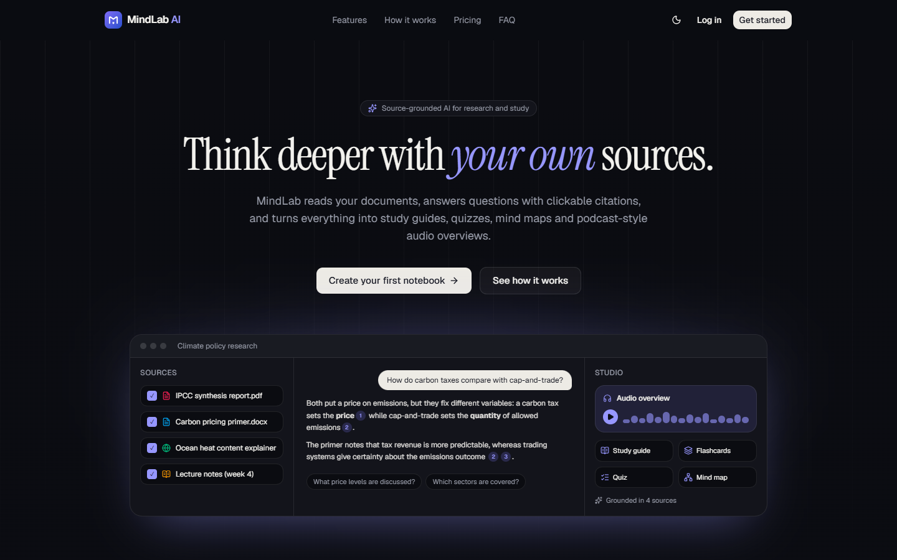
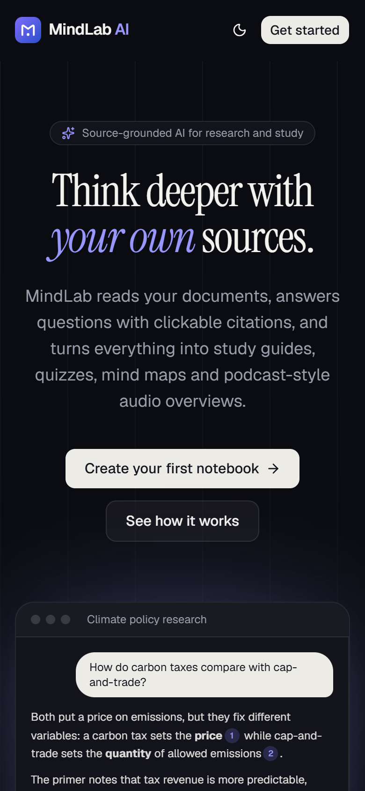
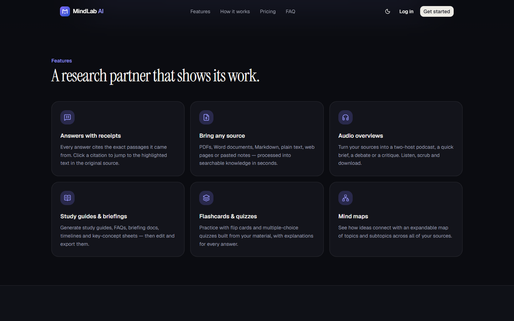
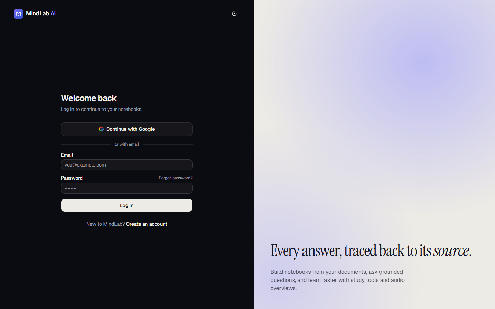

<div align="center">

<a href="https://mindlab-ai-psi.vercel.app">
  
</a>

<br>

<a href="https://mindlab-ai-psi.vercel.app"></a>

<p>
  <a href="https://mindlab-ai-psi.vercel.app"></a>
</p>
<p>
  
  
  
  
  
  
  
  
</p>

**Upload your documents. Ask anything. Every answer comes with clickable citations to the exact passage —<br>then turn your sources into study guides, quizzes, flashcards, mind maps and podcast-style audio.**

</div>

---

## ✨ See it in action

<div align="center">
<table>
  <tr>
    <td width="74%" valign="top">
      <a href="https://mindlab-ai-psi.vercel.app">
        <picture>
          <source media="(prefers-color-scheme: dark)" srcset="docs/assets/readme/landing-dark.png">
          <source media="(prefers-color-scheme: light)" srcset="docs/assets/readme/landing-light.png">
          
        </picture>
      </a>
      <p align="center"><sub>Desktop · follows your GitHub light/dark theme</sub></p>
    </td>
    <td width="26%" valign="top">
      <a href="https://mindlab-ai-psi.vercel.app"></a>
      <p align="center"><sub>Mobile</sub></p>
    </td>
  </tr>
</table>
</div>

<details>
<summary><b>More screenshots</b></summary>
<br>

| Features | Sign in |
|---|---|
|  |  |

</details>

> [!NOTE]
> The public demo currently runs in **search mode** (no AI provider configured): uploads, the keyword index, the source viewer and sharing all work, and chat quotes the best-matching passages with citations. Written AI answers, Studio and audio switch on when the deployment has a Gemini key or Vercel AI Gateway — see [AI provider](#ai-provider-optional).

---

## 🧠 How it works

<div align="center">
  
</div>

1. **Add sources** — PDFs, Word documents, Markdown, plain text, web pages or pasted notes.
2. **Index** — text is extracted, split into page-aware passages, embedded into vectors (pgvector) and keyword-indexed.
3. **Ask** — hybrid search retrieves only passages from *this* notebook's selected sources; the model must answer from them.
4. **Verify** — every `[n]` citation is checked against what was actually retrieved; click one to open the source with the passage highlighted.

## 🚀 Features

<div align="center">
  
</div>

<table>
<tr>
<td valign="top" width="50%">

**📚 Notebooks & sources**
- Create, rename, archive, duplicate, delete
- Search titles *and* full source text
- Live processing status, retry and reprocess
- Read-only public share links

**💬 Grounded chat**
- Streaming answers, stop / regenerate / copy / save
- Validated numbered citations → exact passage
- Suggested and follow-up questions
- Chat styles: default, learning guide, custom

</td>
<td valign="top" width="50%">

**🎓 Studio**
- Study guide · FAQ · Briefing doc · Timeline
- Key concepts · Revision notes · Source comparison
- Flashcards · Quiz · Mind map
- Edit, regenerate, export (Markdown / JSON / CSV)

**🎧 Audio overviews**
- Deep dive, brief, debate or critique
- Two voices, three lengths, focus prompt
- Real multi-speaker TTS → MP3, transcript, history

</td>
</tr>
</table>

**🔒 Security built in:** Row Level Security on every table · composite ownership keys · private storage · SSRF-safe URL import · upload validation · prompt-injection fencing · rate limits · no service-role key anywhere.

---

## 🛠️ Quick start

### 1. Install
```bash
npm install
```

### 2. Supabase
1. Create a project at https://supabase.com.
2. Apply the migrations (creates tables, RLS, pgvector, functions, private buckets):
   ```bash
   npx supabase link --project-ref <your-ref>
   npx supabase db push
   ```
   or run the four `supabase/migrations/*.sql` files in order in the SQL editor.
3. **Authentication → URL configuration:** Site URL = your app URL; add redirect URLs `http://localhost:3000/auth/callback` and `<prod-url>/auth/callback` (and `/auth/confirm`).
4. **Google sign-in:** Authentication → Providers → Google; add OAuth client ID/secret from Google Cloud with redirect URI `https://<ref>.supabase.co/auth/v1/callback`.

### 3. Environment
```bash
cp .env.example .env.local
```

| Variable | Where to get it |
|---|---|
| `NEXT_PUBLIC_SUPABASE_URL` | Supabase → Project Settings → API |
| `NEXT_PUBLIC_SUPABASE_PUBLISHABLE_KEY` (or `NEXT_PUBLIC_SUPABASE_ANON_KEY`) | Supabase → Project Settings → API keys |
| `NEXT_PUBLIC_SITE_URL` | Your app URL (`http://localhost:3000` locally) |
| `GEMINI_API_KEY` (optional) | https://aistudio.google.com/apikey — see "AI provider" below |

The Supabase **service-role key is not needed** — all server work runs with the signed-in user's token so Row Level Security always applies.

### AI provider (optional)
MindLab runs in one of three modes (`AI_PROVIDER`, default `auto`):

| Mode | How to enable | What works |
|---|---|---|
| **Gemini** | set `GEMINI_API_KEY` | Everything |
| **Vercel AI Gateway** | `AI_PROVIDER=gateway` on Vercel (no key — uses the deployment's OIDC token; the Vercel team needs a credit card on file to unlock gateway credits), or `AI_GATEWAY_API_KEY` anywhere | Everything (same Gemini models via the gateway) |
| **Search mode** | nothing configured | Notebooks, uploads, keyword-indexed sources, source viewer, sharing; chat quotes the best-matching passages with citations. Studio and audio are disabled. |

After switching from search mode to an AI provider, use **Reprocess** on existing sources to add AI embeddings (keyword search keeps working either way).

### 4. Run
```bash
npm run dev
```

## ☁️ Deploy (Vercel)
1. Import the repository in Vercel; framework preset Next.js.
2. Add the environment variables above (Production and Preview).
3. Background work runs within each route's `maxDuration` (300 s, the Hobby limit). On Pro with Fluid compute you can raise the audio route to 800 s for very long episodes.
4. Add the production URL to Supabase redirect URLs.

Every push to `main` deploys to production automatically.

## 🧪 Testing
```bash
npm run check      # lint + typecheck + unit, database (PGlite) and API integration tests
npm run test:e2e   # production build + Playwright (desktop & mobile)
GEMINI_API_KEY=... npm run test:live    # real Gemini embeddings, JSON, grounded answers, TTS
npm run test:live:gateway               # same checks through Vercel AI Gateway (uses .env.local)
```
See [`docs/testing-report.md`](docs/testing-report.md) for the latest results.

## 📖 Documentation
- [`docs/reverse-engineering-report.md`](docs/reverse-engineering-report.md) — product research, method and limits, feature comparison, workflow
- [`docs/requirements.md`](docs/requirements.md) — functional & non-functional requirements with status
- [`docs/architecture.md`](docs/architecture.md) — system design, flows, security model, decisions
- [`docs/database-schema.md`](docs/database-schema.md) — tables, indexes, RLS, functions, storage
- [`docs/api-reference.md`](docs/api-reference.md) — every endpoint and the chat streaming protocol
- [`docs/implementation-roadmap.md`](docs/implementation-roadmap.md) — what's done, go-live checklist, next steps
- [`docs/testing-report.md`](docs/testing-report.md) — results and coverage

<div align="center">
<br>
<a href="https://mindlab-ai-psi.vercel.app"></a>
<br><br>
<sub>Built with Next.js, Supabase and Gemini · An independent project</sub>
</div>
