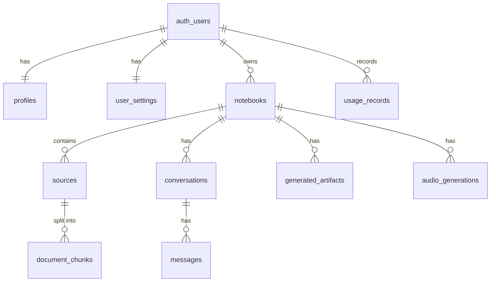

# Database schema

Source of truth: `supabase/migrations/` — `20261103000000_initial_schema.sql`, `20261103000100_storage.sql` and `20261103000200_hardening.sql` (revokes API access to the sign-up trigger function and adds covering indexes for the composite ownership foreign keys). Every primary key is a UUID; every table has `created_at` / `updated_at` (maintained by a trigger).



## Tables

### profiles
`id` (PK, FK → auth.users, cascade) · `email` · `full_name` · `avatar_url`. Created by trigger `on_auth_user_created`.

### user_settings
`user_id` (PK, FK) · `theme` (system/light/dark) · `chat_model` · `chat_style` (default/learning/custom) · `custom_instructions` (≤2000) · `response_length` (short/default/long) · `audio_host_voice` · `audio_guest_voice`. Created by the same trigger.

### notebooks
`id` · `user_id` · `title` (1–200) · `description` · `emoji` · `is_archived` · `summary` · `suggested_questions` jsonb · `share_enabled` · `share_token` (unique) · `last_opened_at`. `UNIQUE (id, user_id)` is the target of child composite FKs.
Indexes: `(user_id, is_archived, last_opened_at desc)`, GIN on `to_tsvector(title)`.

### sources
`id` · `notebook_id` · `user_id` · `title` · `kind` (pdf/docx/txt/md/url/text) · `status` (pending/processing/ready/failed) · `error` · `storage_path` · `mime_type` · `file_size` · `url` · `extracted_text` · `page_offsets int[]` · `page_count` · `word_count` · `chunk_count` · `summary` · `is_selected` · `is_bookmarked` · `attempts` · `processing_started_at`.
FK `(notebook_id, user_id) → notebooks(id, user_id)` cascade. `UNIQUE (id, user_id)`.
Indexes: `(notebook_id, created_at)`, `(user_id, updated_at desc)`.

### document_chunks
`id` · `source_id` · `notebook_id` · `user_id` · `chunk_index` · `content` · `page_start` · `page_end` · `char_start` · `char_end` (offsets into `sources.extracted_text`) · `token_count` · `embedding vector(768)` · `fts tsvector` (generated, english).
FKs `(source_id, user_id) → sources`, `(notebook_id, user_id) → notebooks` (both cascade). `UNIQUE (source_id, chunk_index)`.
Indexes: `(notebook_id, source_id)`, GIN on `fts`, **HNSW** on `embedding vector_cosine_ops`.

### conversations
`id` · `notebook_id` · `user_id` · `title`. FK `(notebook_id, user_id)`. `UNIQUE (id, user_id)`. Index `(notebook_id, updated_at desc)`.

### messages
`id` · `conversation_id` · `notebook_id` · `user_id` · `role` (user/assistant) · `content` · `citations` jsonb (validated citations: index, chunkId, sourceId, title, excerpt, pages, char range) · `follow_up_questions` jsonb · `status` (streaming/complete/stopped/error) · `model` · `is_saved`.
FKs `(conversation_id, user_id)`, `(notebook_id, user_id)`. Indexes `(conversation_id, created_at)`, partial `(notebook_id) where is_saved`.

### generated_artifacts
`id` · `notebook_id` · `user_id` · `type` (study_guide, faq, briefing, timeline, key_concepts, flashcards, quiz, mind_map, comparison, revision_notes) · `title` · `content` (Markdown) · `data` jsonb (flashcards/quiz/mind map) · `status` (generating/ready/failed) · `error` · `source_ids uuid[]` · `model`. Index `(notebook_id, created_at desc)`.

### audio_generations
`id` · `notebook_id` · `user_id` · `status` (queued/scripting/synthesizing/encoding/ready/failed) · `progress` 0–100 · `format` · `length` · `focus_prompt` · `title` · `script` jsonb · `storage_path` · `mime_type` · `duration_seconds` · `file_size` · `error` · `source_ids` · `model` · `tts_model` · `voices` jsonb. Index `(notebook_id, created_at desc)`.

### usage_records
`id` · `user_id` · `notebook_id` (set null on delete) · `kind` (chat/embedding/generation/tts/ingest/audio) · `model` · `input_tokens` · `output_tokens` · `units` · `metadata`. Index `(user_id, kind, created_at desc)` — used for rate limiting.

## Row Level Security

| Table | select | insert | update | delete |
|---|---|---|---|---|
| profiles | own | (trigger) | own | — |
| user_settings | own | own | own | — |
| notebooks, sources, document_chunks, conversations, messages, generated_artifacts, audio_generations | own | own | own | own |
| usage_records | own | own | **—** | **—** |

"own" = `user_id = (select auth.uid())` for the `authenticated` role. `anon` has no table access.

## Functions
- `match_chunks(p_notebook_id, p_query_embedding vector(768), p_query_text, p_source_ids uuid[], p_match_count)` — hybrid search with RRF; `SECURITY INVOKER` so RLS applies; capped at 50 rows.
- `search_chunks_text(p_notebook_id, p_query_text, p_source_ids uuid[], p_match_count)` — keyword-only retrieval used when no AI provider is configured: OR-ed query lexemes, ranked by `ts_rank_cd`; `SECURITY INVOKER`; works for chunks with or without embeddings. (Migration `20261103000300_keyword_search.sql`.)
- `get_shared_notebook(p_token)` — `SECURITY DEFINER`, `search_path=''`; returns notebook overview, ready sources (title/kind/word count/summary) and ready artifacts for an enabled, non-archived notebook with a ≥24-char token. Never returns extracted text, chunks, chats or audio.
- `handle_new_user()` trigger, `set_updated_at()` trigger.

## Storage
Buckets `sources` (50 MB limit; PDF/DOCX/TXT/MD mime allow-list) and `audio` (100 MB; MP3/WAV), both private. Policies allow select/insert/update/delete only when the first path segment equals `auth.uid()`.

## Applying migrations
```bash
supabase link --project-ref <ref>
supabase db push
```
or paste the three files, in order, into the Supabase SQL editor.
