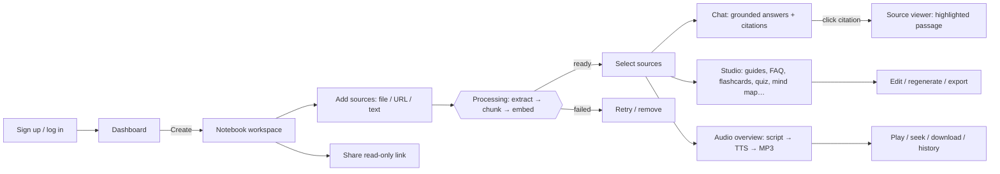

# Reverse-engineering & product research report

**Target:** Google NotebookLM (`https://notebooklm.google.com/`) — observed on 2026-11-03.
**Purpose:** understand user-visible capabilities and interaction patterns to design MindLab AI, an independent product. No proprietary code, assets or branding were recovered or reused.

---

## 1. Method and its limits (read this first)

| Step | What happened | Result |
|---|---|---|
| REA availability | The REA toolkit (`morluto/rea`, v6.8.0) is cloned at `../rea`. Its MCP server is **not registered** in this Claude Code session (no `rea` tools were available). | REA could not be invoked via MCP. |
| REA web capability | Per `rea/docs/browser-observation.md`, REA inspects websites only by attaching over Chrome DevTools Protocol to a **user-owned, already-open** Chrome page (`inspect_web_page`, `observe_web_session`, `analyze_web_bundle`). | Would require a signed-in Google session in the user's Chrome. |
| Authentication | NotebookLM requires a Google account. I did **not** sign in on the user's behalf, did not use private endpoints, and did not bypass any access control. | Logged-in UI, network traffic and JS bundles were **not** inspected. |
| Public observation | `notebooklm.google` now 301-redirects to `notebook.google`, whose page title is "Gemini Notebook \| AI Research Tool & Thinking Partner" (body is client-rendered; no readable text was returned). | Product appears to have been renamed to **Gemini Notebook**. |
| Public documentation | Read the official Help Center (`support.google.com/notebooklm/...`, which now serves `/gemininotebook/` content). | Primary evidence for all findings below. |

**Consequently, every finding below is "documented behaviour" (verified against Google's public help pages), not observed runtime internals.** Anything about implementation is explicitly marked as an *assumption*. To extend this report with runtime evidence, sign in to NotebookLM in your own Chrome, register REA (`npx rea-agents setup`), and run `inspect_web_page` / `observe_web_session` against that tab.

### Sources consulted

- [S] Sources — https://support.google.com/gemininotebook/answer/16215270
- [C] Chat — https://support.google.com/gemininotebook/answer/16179559
- [N] Notes — https://support.google.com/gemininotebook/answer/16262519
- [R] Reports — https://support.google.com/gemininotebook/answer/18323649
- [L] Usage limits — https://support.google.com/gemininotebook/answer/17670842
- [A] Audio Overviews — https://support.google.com/notebooklm/answer/16212820
- [O] Learn about — https://support.google.com/notebooklm/answer/16164461

---

## 2. Findings by feature

Legend: **V** = verified in official documentation · **A** = assumption / inference · **L** = limitation of this research.

### 2.1 Application architecture & visible interface structure
- **V** Three working areas: **Sources** (left), **Chat** (centre), **Studio** (right) [N][S][C][R].
- **V** Studio generation runs in the background; you can start other artifacts meanwhile [A].
- **A** Single-page web app with client-side rendering (landing page returned no server-rendered body text).
- **L** No bundle/route/endpoint analysis was performed (requires signed-in CDP session).
- **UI components:** source list with checkboxes, chat thread + composer, Studio tiles + generated-item list, per-item three-dot menus.

### 2.2 Dashboard and notebook creation
- **V** Notebooks are the unit of work; sharing/privacy is per notebook [A][R].
- **L** Dashboard layout (cards vs list, sort order) not documented in pages read; not observed.
- **MindLab design:** card grid with search, active/archived tabs, recently added sources.

### 2.3 Source upload and management
- **V** "Add sources" button in the Sources panel; each source has a checkbox that includes/excludes it from chat and generation [S].
- **V** Notes can be converted to sources; pasted text is added as "Copied text" [N].
- **V** Labels appear once a notebook has 5+ sources [S].

### 2.4 Supported formats & limits
- **V** Types: PDF, DOCX, TXT, MD, CSV, PPTX, ePub, images, audio (MP3/WAV…), Google Docs/Slides/Sheets, web URLs, public YouTube URLs (with captions), pasted text, notes, Play Books, Gemini chats [S].
- **V** Per source: up to 500,000 words or 200 MB; Slides ≤100 slides; Sheets ≤100k tokens [S].
- **V** Up to 50 sources per notebook on the free plan; usage limits are compute-based, refresh every 5 hours with a weekly cap [S][L].
- **V** Web import takes page text only (no images/embedded video/nested pages); paywalled pages unsupported [S].
- **MindLab scope:** PDF, DOCX, TXT, MD, URL, pasted text (the formats the brief requires). 25 MB default per file, 50 sources/notebook, ~500k words per source.

### 2.5 Document processing & ingestion behaviour
- **V** Sources are processed before use; failures can come from safety filters or unreadable content [O].
- **A** Text extraction → chunking → embedding/indexing for retrieval (standard RAG; not documented by Google).
- **L** Processing pipeline internals not observable without runtime inspection.

### 2.6 Notebook-based AI conversation
- **V** Answers are based only on the notebook's sources; creative/out-of-scope requests may be declined [C].
- **V** "Configure Chat": styles Default, Learning Guide, Custom (e.g. "Respond like a PhD student") plus response length [C].
- **V** Chat history is retained, private to the user, clearable via a menu [C].

### 2.7 Source-grounded answers & 2.8 inline citations
- **V** Responses include citations; hovering shows the quoted text; selecting a citation jumps to the passage in context in the source [C].
- **V** Saved notes keep clickable inline citations [N].
- **A** Citations are numbered markers mapped to retrieved passages (the docs say "citation chips", not numbers).
- **MindLab design:** numbered chips; popover with source, page and passage; "Open in source" highlights the exact character range.

### 2.9 Suggested questions
- **L** Not described in the help pages read. **A** NotebookLM shows suggested questions after sources load (widely reported; not verified here).
- **MindLab design:** notebook overview + 3 suggested questions generated after processing; 3 follow-ups after each grounded answer.

### 2.10 Summaries, 2.11 study guides & FAQ
- **V** Studio "Reports" have two modes: Interactive (web-only) and Document (templates such as study guide, briefing doc, FAQ, timeline; editable; generate now or later) [R].
- **V** Studio outputs listed in Help Center navigation: Audio Overview, Video Overviews, Mind Maps, Flashcards/Quizzes, Infographic, Slide Decks, Reports.

### 2.12 Audio Overview
- **V** Formats: Deep Dive (two hosts, default), The Brief (single speaker, < 2 min), The Critique, The Debate [A].
- **V** Lengths: Shorter / Default / Longer; 80+ languages; a custom prompt focuses the episode [A].
- **V** Generation takes "a couple of minutes", runs in the background; playback speed control; download; earlier overviews can be loaded [A].
- **V** Interactive mode lets the listener "join" by voice (English only) [A].
- **MindLab scope:** all four formats, three lengths, focus prompt, two configurable voices, real multi-speaker TTS, MP3 storage, history, transcript. Interactive voice mode and multi-language output are out of scope (see roadmap).

### 2.13 Notebook organisation
- **V** Notes live in the Sources panel and can be used as sources; "Export to Docs" exists [N].
- **MindLab design:** saved responses, source bookmarks, archive/duplicate notebooks, Markdown/JSON/CSV export.

### 2.14 Search and navigation
- **L** Global search behaviour not documented in pages read. **MindLab design:** notebook title search + full-text search over all source content.

### 2.15 Loading, error and empty states
- **V** Documented error causes: safety flags, unclear phrasing, information not in sources [O]; usage-limit messages [L].
- **L** Visual treatment not observed. **MindLab design:** skeletons, per-source processing status, retryable failures with user-facing messages.

### 2.16 Responsive behaviour
- **V** A mobile app exists with reduced capabilities (e.g. notes viewable but not editable) [N].
- **L** Mobile web layout not observed. **MindLab design:** the three panels become bottom tabs below the `lg` breakpoint.

### Sharing (observed while researching)
- **V** Owners/editors can share a notebook (viewer/editor) or with "Anyone with a link"; shared notebooks expose Studio artifacts; public sharing is disabled for Workspace Enterprise/Education [A][R].
- **MindLab scope:** owner-controlled read-only public link exposing overview, source list and Studio outputs (never raw text, chats or audio). Per-user viewer/editor ACLs are on the roadmap.

---

## 3. Feature comparison

| Capability | NotebookLM (documented) | MindLab AI (implemented) |
|---|---|---|
| Three-panel workspace | ✅ | ✅ (tabs on mobile) |
| Source types | 15+ incl. Google Drive, YouTube, audio, images | PDF, DOCX, TXT, MD, web URL, pasted text |
| Per-source limit | 500k words / 200 MB | ~500k words / 25 MB (configurable) |
| Sources per notebook | 50 (free) | 50 (configurable) |
| Source selection for chat/Studio | ✅ | ✅ |
| Grounded chat + citations | ✅ hover + jump to passage | ✅ popover + highlighted passage + page |
| Chat styles & length | ✅ Default/Learning/Custom | ✅ Default/Learning/Custom + length |
| Suggested & follow-up questions | (not verified) | ✅ |
| Save responses as notes | ✅ editable notes | ✅ saved responses (read-only) |
| Study guide / FAQ / briefing / timeline | ✅ Reports | ✅ editable + export |
| Flashcards / quiz | ✅ | ✅ interactive + CSV/MD/JSON export |
| Mind map | ✅ | ✅ expandable tree, "ask about node" |
| Key concepts, revision notes, source comparison | — | ✅ |
| Audio overview formats | Deep dive, brief, critique, debate | Same four |
| Audio interactive mode, 80+ languages | ✅ | ❌ (roadmap) |
| Video overviews, infographics, slide decks | ✅ | ❌ (roadmap) |
| Public share link | ✅ | ✅ read-only projection |
| Per-user sharing roles | ✅ | ❌ (roadmap) |

---

## 4. Application workflow

The resulting requirements, architecture, schema and roadmap are in `requirements.md`, `architecture.md`, `database-schema.md` and `implementation-roadmap.md`.
